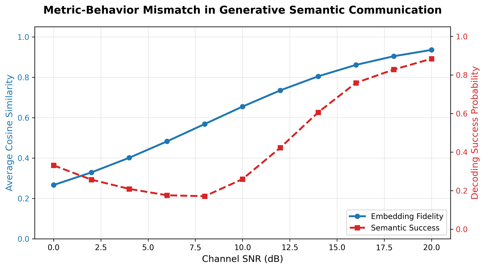
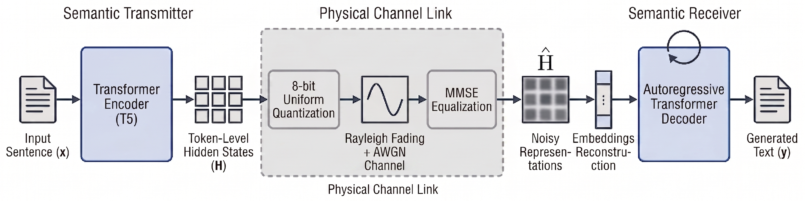

# Generative Semantic Communication Under Noise Using Transformers

[](LICENSE)
[](https://python.org)
[]()

This repository contains the code and data for the paper below. Cosine similarity between transmitted and received embeddings degrades smoothly with channel noise. Autoregressive decoding does not: it fails abruptly, before the embedding metric shows a problem.

---

## Paper

| | |
|---|---|
| **Title** | Generative Semantic Communication Under Noise Using Transformers |
| **Venue** | IEEE ANTS 2026 (International Conference on Advanced Networks and Telecommunications Systems), IIT Roorkee |
| **Status** | Accepted. Camera-ready in progress. Paper text may change before final publication. |
| **Preprint** | [`paper/GenSemCom_ANTS2026_preprint.pdf`](paper/GenSemCom_ANTS2026_preprint.pdf) (submitted version, in this repo) |
| **Full paper** | [Google Drive](https://drive.google.com/file/d/13nbO8dCJnvolcJ4QRlWr0cPmIgBSgVqn/view?usp=drivesdk) |

### Citation

Jai and Aggam Singh Arora contributed equally as first authors. The paper is not on IEEE Xplore yet. Volume, page numbers, and DOI will be added once it is published; use the entry below until then.

```bibtex
@inproceedings{gensemcom2026ants,
  title     = {Generative Semantic Communication Under Noise Using Transformers},
  author    = {Jai and Aggam Singh Arora and Navneet Nayan and Radhika Gour and Suneel Yadav},
  booktitle = {2026 IEEE International Conference on Advanced Networks and Telecommunications Systems (ANTS)},
  year      = {2026},
  address   = {IIT Roorkee, India},
  volume    = {TBD},
  pages     = {TBD},
  doi       = {TBD},
  note      = {Accepted; camera-ready in progress}
}
```

---

## Results

The system uses a T5-small encoder, 8-bit quantization, BPSK modulation, a Rayleigh fading and AWGN channel, MMSE equalization, and an autoregressive T5-small decoder. We swept SNR from 0 to 20 dB and measured embedding cosine similarity and decoding success at each point.



Cosine similarity (blue) rises smoothly and monotonically with SNR. Decoding success (red) does not follow the same curve. It reaches its minimum around 6-8 dB, well before cosine similarity shows any significant drop. A high cosine similarity score does not mean the decoder is producing usable output.

Table I from the paper shows actual decoder output at each SNR:

| SNR | Cosine Sim. | Collapse Prob. | Decoding State | Example output |
|---|---|---|---|---|
| Clean | 1.00 | 0.00 | Baseline | "The rapid advancement of artificial intelligence has reshaped modern telecommunications." |
| 20 dB | 0.96 | 0.07 | Stable generation | "The rapid progress of artificial intelligence has reshaped modern telecommunications." (minor synonym swap) |
| 15 dB | 0.87 | 0.20 | Semantic distortion | "The rapid advancement of artificial networks has reshaped the telecommunications." (grammatical degradation) |
| 10 dB | 0.71 | 0.60 | Structural collapse | "The the the the the the tele tele the the the tele the." (autoregressive feedback-loop failure) |
| 5 dB | 0.48 | 0.94 | Total breakdown | "... ... ... ... ... ..." |
| 0 dB | 0.32 | 1.00 | Total breakdown | "! ! ! ! ! ! ! ! !" |

At 10 dB, cosine similarity is 0.71, while the decoder collapses 60% of the time.

We also measured reconstruction quality with BLEU, ROUGE-L, and BERTScore (F1):

| SNR (dB) | BLEU | ROUGE-L | BERTScore (F1) |
|---|---|---|---|
| 20 | 18.79 | 0.292 | 0.857 |
| 15 | 12.79 | 0.196 | 0.842 |
| 10 | 2.70 | 0.042 | 0.801 |
| 5 | 0.10 | 0.010 | 0.771 |

BERTScore stays high while BLEU drops because the decoder paraphrases the source instead of reproducing it exactly, which lowers n-gram overlap without necessarily changing the meaning. Of the three metrics, BERTScore (F1) tracked output quality most reliably in our experiments.

---

## System architecture



A sentence is encoded into token-level hidden states by a T5-small encoder, quantized to 8 bits, BPSK-modulated, sent through a Rayleigh fading and AWGN channel, MMSE-equalized, dequantized, and decoded token by token by an autoregressive T5-small decoder. The transmitted representation is a continuous embedding, not a bitstream reconstructed exactly.

We also ran a retrieval-based control baseline. A frozen `all-MiniLM-L6-v2` sentence transformer maps each sentence to a 384-d embedding. The embedding goes through the same channel and quantization pipeline, and the receiver recovers the sentence by nearest-neighbor search against a local database instead of generation. Code: [`src/minilm_model/`](src/minilm_model/).

---

## Repository structure

```
.
├── paper/
│   └── GenSemCom_ANTS2026_preprint.pdf   <- submitted paper (camera-ready pending)
├── data/
│   ├── README.md                          <- data provenance and license (CC BY-SA, see below)
│   ├── processed/10k_sentences.json       <- 10,000-sentence diagnostic corpus
│   └── raw/1k_sentences_random.json       <- 1,000-sentence subset for BLEU/ROUGE-L/BERTScore
├── src/
│   ├── semantic_embeddings_T5small.ipynb  <- the T5 generative transceiver, reference implementation
│   ├── data_loader.py                     <- corpus loading helper
│   └── minilm_model/                      <- MiniLM retrieval control baseline (paper Sec. IV-A)
│       ├── encoder.py                     <- embed the corpus with MiniLM
│       ├── channel.py                     <- quantization + Rayleigh/AWGN/BPSK + MMSE for embeddings
│       ├── evaluate.py                    <- cosine similarity vs. SNR
│       ├── evaluate_retrieval.py          <- top-1 / top-k retrieval accuracy vs. SNR
│       └── decoder.py                     <- qualitative nearest-neighbor examples
├── results/
│   ├── fig1-system-model.png              <- Fig. 1 of the paper
│   └── fig2-metric-behavior-mismatch.png  <- Fig. 2 of the paper
├── requirements.txt
└── LICENSE
```

The T5 generative transceiver is implemented entirely in `src/semantic_embeddings_T5small.ipynb`. There is no separate `.py` module for it.

---

## Data

`data/processed/10k_sentences.json` and `data/raw/1k_sentences_random.json` are the corpora used in the paper. Sentences were sampled from a Wikipedia scrape and filtered to 4-64 characters to avoid padding artifacts. The code in this repository is MIT licensed. The sentence data is CC BY-SA 4.0, inherited from Wikipedia. See [`data/README.md`](data/README.md) before redistributing it.

---

## Acknowledgments

This work was carried out under the mentorship of Navneet Nayan (lead mentor), with additional guidance from Radhika Gour and Suneel Yadav.
